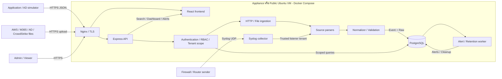

# Architecture — Demo Log Management

สถานะ: **ข้อเสนอการออกแบบ ยังไม่ได้ Implement/Validate** | ฉบับร่าง 2026-10-13

อ้างอิง Assignment §2 Scope, §3 Schema, §5 Architecture, §6 Deliverables, §7 Acceptance และ §8 Scoring

## 1. เป้าหมายและขอบเขต

สร้างระบบเดโมที่รับ Log หลายแหล่ง แปลง Schema ก่อนจัดเก็บ แล้วให้ผู้ใช้ค้นหา ดูภาพรวม และรับ Alert โดยไม่อ่านข้อมูลข้าม Tenant โดยไม่ได้รับอนุญาต

ข้อกำหนดโจทย์: Syslog/HTTP JSON/File batch, อย่างน้อย 2 โปรโตคอล, 4 เส้นทางที่ส่งได้จริง, Source coverage ครบกลุ่มที่ระบุ, Dashboard/Search, Alert, Admin/Viewer, Tenant isolation, Retention ≥7 วัน, Appliance และ SaaS HTTPS

ข้อเสนอแนะ: ใช้ Modular monolith แบ่ง Module ชัด และแยก Process เฉพาะ API, Collector และ Worker แทนการกระจายเป็น Microservices หลายตัว

## 2. แผนภาพ

Parser/Normalizer เป็น Shared module ที่ใช้ใน API และ Collector ไม่ใช่ Network service เพิ่ม Alert engine ทำงานโดยไม่ต้องมีผู้ใช้เปิด Dashboard

## 3. Components และเหตุผล

| Component | หน้าที่ | เหตุผล/ข้อจำกัด |
| --- | --- | --- |
| React/Vite/TypeScript | Login, Explorer, Detail, Dashboard, Alerts, Rule form, Upload | UI ที่เน้นฟังก์ชัน; ไม่ทำ Design system เต็มรูปแบบ |
| Express/TypeScript | Auth, Query, Ingest, Rule management | ใช้ภาษาเดียวและแชร์ Validation |
| PostgreSQL | Users, Tenants, Events, Rules, Alerts | ลดจำนวน Services; ต้องกำหนด Index/Pagination |
| UDP collector | รับ Syslog บน 5514 ภายใน Container | ทำงานง่าย; UDP ไม่มีการรับประกัน Delivery |
| Worker | ประเมิน Alert และลบข้อมูลหมดอายุ | แยกงานจาก HTTP lifecycle |
| Nginx | Reverse proxy, TLS, Request size limit | เปิด Public entry point เดียวสำหรับ Web/API |

PostgreSQL ใช้ Typed columns สำหรับ Query หลัก และ JSONB สำหรับ Attributes ตาม [Schema](schema.md) OpenSearch/ClickHouse เหมาะหากปริมาณหรือรูปแบบ Query ต้องการ แต่ยังไม่จำเป็นสำหรับเดโม 10 วัน

## 4. Ingestion contract และ Data flow

### HTTP

1. รับ Object/Array ที่ `POST /ingest`; `/api/ingest` เป็น Alias ของ Handler เดียวกัน
2. ตรวจ API key ที่ผูก Tenant/Allowed sources และจำกัด Rate/ขนาด
3. หาก Tenant ใน Payload ขัดกับ Key ให้ 403; ไม่เลือก Tenant จาก Body อย่างเดียว
4. เลือก Parser จาก Source ที่อยู่ใน Allowlist แล้ว Normalize/Validate
5. ตรวจทั้ง Batch ก่อนเขียนใน Transaction; มี Record ผิดให้ 422 พร้อม Index และไม่เขียนทั้ง Batch
6. ตอบ 201 พร้อม Accepted count หลัง Commit เท่านั้น; DB ไม่พร้อมให้ 503

### Syslog

1. รับ Datagram ที่ Listener; Tenant ผูกกับ Config ของ Listener
2. แยก Header/PRI และ Key-value; ระวัง Value ที่มีช่องว่าง
3. Normalize และเขียนผ่าน Storage module
4. บันทึก Parse/Write failures และ Drop count; ไม่ถือว่า UDP sender ได้รับ Commit acknowledgment
5. UI Poll 5–10 วินาที เป้าหมายให้เห็น Log ภายใน 1 นาทีตาม Acceptance

MVP ใช้ Listener สำหรับ Tenant เดโมที่กำหนดไว้ หากมีหลาย Tenant ต้องแยก Listener/Port ที่ผูก Tenant หรือใช้ Forwarder ที่ยืนยันตัวตน ห้ามใช้ Tenant text ใน Syslog เป็นหลักฐานสิทธิ์

### File

รับ Multipart upload โดย Admin หรือ API key ที่มีสิทธิ์ Parse JSON Object/Array หรือ NDJSON ใช้ Pipeline เดียวกับ HTTP ไม่รับ Arbitrary server path/Remote URL และไม่ Execute ไฟล์

ค่าเริ่มต้นที่เสนอ: HTTP body 1 MiB; Upload 5 MiB; Batch สูงสุด 1,000 Records ต้องปรับจากผลทดสอบและตั้ง Nginx/Application ให้สอดคล้องกัน ตรวจจำนวน Records ก่อน Transaction; Unsupported content ให้ Error ชัดเจน

Sample ทุก Source ต้องผ่าน Ingest จริง ไม่ Insert SQL เพื่ออ้างว่าเชื่อม Source สำเร็จ

## 5. Tenant และ Role model

**ข้อเสนอการออกแบบ:** Viewer ผูก Tenant เดียว; Admin เป็น Platform Admin ที่มีสิทธิ์เลือก Tenant ที่มีอยู่จริง หากอนาคตมี Tenant Admin ต้องสร้าง Permission model เพิ่ม ไม่ถือว่า Admin ของลูกค้ามีสิทธิ์ทั่วระบบ

| Identity | Read | Write |
| --- | --- | --- |
| Viewer | Logs/Dashboard/Alerts/Rules ของ Tenant ตน | ไม่สร้าง Rule, Upload หรือจัดการผู้ใช้ |
| Platform Admin | Tenant ที่เลือกอย่างชัดเจน | สร้าง/แก้ Rule และ Upload ใน Tenant ที่เลือก |
| Ingest API key | ไม่มีสิทธิ์อ่าน Logs | เขียนเฉพาะ Tenant/Source ที่ผูกไว้ |
| Collector | ไม่มี User UI | เขียน Tenant จาก Trusted config |
| Worker | Internal job context แยก Tenant | Alert/Retention ตาม Tenant |

Backend สร้าง Scope กลางก่อน Query ทุกครั้ง Viewer ระบุ Tenant อื่นให้ 403; การเปิด Resource ID ต่าง Tenant ให้ 404; Admin ไม่ระบุ Tenant ใน Scoped endpoint ให้ 400 ไม่คืนทุก Tenant โดยปริยาย

ทุก Query รวม Search, Detail, Counts, Top N, Timeline, Alert และ Rule ต้องบังคับ Scope รวมถึง Cursor และ Cache ถ้ามี Foreign key ของ Alert ต้องตรวจ Tenant ให้ตรง Rule

MVP ใช้ Application-level scoping และ Negative integration tests; PostgreSQL RLS เป็นชั้นป้องกันเพิ่มเติมหากมีเวลา ต้องใช้ Non-owner role ที่ไม่ BYPASSRLS และ Transaction-local context เมื่อใช้ Connection pool RLS ไม่เท่ากับ Bonus แยก Table/Index

## 6. Authentication และ Security

- Password hash ด้วย Argon2id; ไม่มี Plaintext password ใน DB หรือ Repository
- JWT อายุสั้น เช่น 15 นาที; ตรวจ Signature, Algorithm allowlist, Issuer, Audience, Expiration และ Active user
- Claims: sub, role, tenant_id, iss, aud, iat, exp, jti; Backend เป็นผู้ลงนาม ไม่เชื่อ Claims ที่ไม่ได้ Verify
- UI เก็บ Access token ใน Memory; Refresh แล้ว Login ใหม่ได้ใน MVP; Logout ล้าง Token แต่ Token ที่ถูกคัดลอกยังมีอายุจน Expire หากยังไม่มี Revocation
- API key เก็บ Hash และ Prefix ใน DB; ไม่ใช้ Viewer JWT แทน Ingestion credential
- SQL parameters สำหรับ Values; Allowlist สำหรับ Sort/Bucket/Column
- Render Raw เป็น Text; ไม่ใช้ Raw HTML; ใช้ CSP และ Same-origin frontend/API
- จำกัด Login/Ingest rate, Payload size, Query time range และ Pagination
- ไม่ Log Authorization header, Password, Token หรือ API key
- จำกัดเครือข่าย Syslog; ไม่เปิด Database ออก Internet

## 7. Query และ Dashboard

Endpoint ที่วางแผน: `/api/logs`, `/api/logs/:id`, `/api/dashboard/summary`, `/timeline`, `/top-ips`, `/top-users`, `/top-event-types` ภายใต้ Dashboard prefix

ทุก Dashboard endpoint ใช้ Tenant/Source/Time filters แบบเดียวกัน: ช่วง `[from,to)` โดยเก็บ UTC และแสดง Timezone ชัด Pagination ใช้ `(event_timestamp,id)` เป็น Cursor และตรวจ Scope ใหม่ทุก Request

Raw substring search จำกัด Tenant/Time และจำนวนผลลัพธ์; ไม่อ้างว่า JSONB GIN เร่ง Raw text search ได้ หลีกเลี่ยงสร้าง Index ทุก Field โดยไม่มี Query รองรับ

## 8. Alert

โจทย์ต้องการกฎอย่างน้อยหนึ่งแบบและสร้างกฎตัวอย่างได้ ข้อเสนอ: Failed login ≥5 ครั้งจาก IP เดิมใน Tenant เดียวภายใน 300 วินาที

- Admin สร้าง Rule ผ่าน UI/API; ไม่ Hard-code กฎอย่างเดียว
- Worker ประเมินทุก 10 วินาทีด้วย Evaluation time ค่าเดียวต่อรอบ
- Match: event_type=authentication, outcome=failure, src_ip ไม่ Null และ `evaluation_time - window < event_timestamp <= evaluation_time`
- Group ด้วย Tenant และ IP; ไม่รวม Count ข้าม Tenant
- บันทึก Alert พร้อม Rule, IP, Count, Window, First/Last seen และ Sample event IDs
- Persistent `alert_state` และ Transaction ป้องกันแจ้งซ้ำใน Cooldown 300 วินาที; Restart ไม่ล้าง State
- UI Poll และแสดง Alert; Email/Webhook เป็น Optional

ข้อจำกัด: Polling มีความละเอียด 10 วินาที; ไม่ Backfill ทุก Historical window; Log ที่มาช้าจนพ้น Window/เวลาอนาคตไม่ Trigger ใช้ Fixture เวลาปัจจุบันสำหรับ Live demo โดยเก็บ Sample ต้นฉบับไว้

## 9. Retention

โจทย์กำหนดอย่างน้อย 7 วัน ข้อเสนอคือนับจาก `received_at` เพื่อเก็บ Sample เก่าที่เพิ่งรับไว้ครบ 7 วัน ส่วน Timeline ใช้ `event_timestamp`

Worker รันทุกชั่วโมง ลบ Batch ที่ `received_at < now - retention_days`; Configuration ต้อง ≥7; บันทึกจำนวนที่ลบและผลรัน ไม่ลบ Users/Rules การลบ Events ไม่ควร Cascade ลบ Alert ทั้งหมดโดยไม่ได้กำหนดนโยบาย ข้อมูลหลักฐานใน Alert อาจมี Event ID ที่หมดอายุและ UI ต้องแจ้งได้

เริ่มด้วย Scheduled delete และ Autovacuum ไม่ทำ Partition จนกว่าจะมีผลทดสอบรองรับความจำเป็น

## 10. Deployment

### Appliance

Ubuntu 22.04+, 4 vCPU, RAM 8 GB, Disk 40 GB ตามโจทย์ Services ที่เสนอ: frontend, backend, postgres, syslog, worker, nginx และ one-shot migrate/seed

- เปิด Web ผ่าน Nginx 80/443; UDP Host 514 → Container 5514 หรือ Host 5514 หากติดข้อจำกัด
- PostgreSQL ใช้ Named volume; ไม่ Publish 5432
- DB healthy → Migration/Seed สำเร็จ → Backend/Worker พร้อมรับงาน
- `/health` ตรวจ Liveness; `/ready` ตรวจ DB/Migration readiness โดยไม่เปิดเผย Secrets
- เป้าหมาย `docker compose up -d` หลังตั้ง Environment; ยังไม่ได้สร้าง Compose

### SaaS

ใช้ Compose เดียวบน Public Ubuntu VM พร้อม Production override, HTTPS และ Persistent volume เปิด 443 และ 80 เท่าที่ต้องใช้ Redirect/Certificate challenge จำกัด SSH/Syslog ตามต้นทาง

Certificate ที่เชื่อถือได้เป็นตัวเลือกแนะนำ; Self-signed ยอมรับได้ตามโจทย์เมื่อมีคู่มือชัดเจน ทดสอบ URL จากภายนอกเครื่องจริง ไม่ถือว่า localhost ผ่าน SaaS acceptance

## 11. Tests, Observability และความเสี่ยง

Tests ขั้นต่ำ: Parameterized normalization; Ingest/Search/Tenant isolation; Alert threshold/window/dedup เพิ่ม Retention boundary และ Health smoke

Operational logs ที่เสนอ: Request ID, Source, Tenant ID ที่ไม่เป็น Secret, จำนวน Accepted/Rejected, Parse failure, Worker failure และ Cleanup count ไม่บันทึก Raw sensitive payload ซ้ำโดยไม่จำเป็น

| ความเสี่ยง | วิธีจัดการ |
| --- | --- |
| UDP loss / DB down | Bounded queue, Failure/drop counter, ส่งใหม่ในเดโม; ไม่รับประกัน Exactly once |
| Timestamp ไม่มีปี/Timezone | Source configuration, Tag เมื่ออนุมาน, Fixture ข้ามปี |
| Tenant leakage | Scope กลาง, Composite FK และ Negative tests ทุกเส้นทาง |
| Alert timing / Historical sample | UTC, Fixed-clock tests, Current-time sender แบบ Explicit |
| Query/Upload ใหญ่ | Limits, Index, Pagination และ Transaction สั้น |
| HTTPS/Firewall ล่าช้า | ตรวจ Cloud ตั้งแต่ต้น; ทดสอบภายนอกก่อนวันส่ง |

## 12. สิ่งที่ยังต้องตัดสินใจ/พิสูจน์

- Cloud provider/Region, URL และ Certificate strategy
- Dependency versions และสเปก VM ที่ผ่านการทดสอบจริง
- Source timezone และขอบเขต Parser fixtures
- Limits/Performance จากข้อมูลสังเคราะห์ที่กำหนดจำนวนชัดเจน

เอกสารนี้ไม่ใช่หลักฐานว่าระบบผ่านเกณฑ์แล้ว ติดตามที่ [Acceptance checklist](acceptance-checklist.md)
